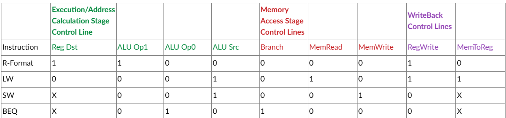

# Coding Assignment 2 — Decode Stage

## Design Scope and Assumptions

- **In scope:** Implement the Instruction Decode (ID) stage of the MIPS pipeline, including the control unit, register file, sign extender, and ID/EX pipeline register.
- **Out of scope:** The fetch stage was implemented separately. Execute, memory access, and writeback stages will be implemented in future assignments. Writeback inputs are supplied by the testbench.
- **Assumptions:** Instructions and data are 32 bits wide, register addresses are 5 bits, and immediate values are 16 bits. The testbench clock toggles every 1 ns, giving a 2 ns period. Clocked modules update on rising edges. Reset is active high. NPC values follow the professor’s PC + 1 convention and are supplied directly by the testbench.
- **Limitations:** Only R-format, LW, SW, and BEQ control decoding is implemented. The register file reads only when regwrite is low and uses clocked read outputs. Only registers 0–9 are initialized. No stall, flush, forwarding, or hazard-detection logic is implemented.

## Requirements

| Requirement | Description | Verification Method |
|---|---|---|
| Latch | Stores control signals, NPC, register data, sign-extended immediate, and instruction register fields | Waveform: ID/EX outputs capture inputs on rising clock edges and clear on reset |
| Register File | Contains 32 registers. Writes writedata into rd when regwrite is high; otherwise reads rs and rt | Waveform: observe initialized register values and read register 2 after writing 32'h00000064 |
| Control | Generates the required control signals for R-format, LW, SW, and BEQ | Waveform: compare control outputs against the control table |
| Sign Extend | Extends a 16-bit immediate to 32 bits by repeating its sign bit | Waveform: compare the instruction’s immediate field with id_ex_sign_ext |
| Final ID Stage | Connects all four components | Behavioral simulation using decodeTB.v |



## Architecture

### Timing or Behavioral Summary

The instruction input is divided into fields. Bits [31:26] provide the opcode to the control unit. Bits [25:21] and [20:16] select the two source registers. Bits [15:0] enter the sign extender.

The control unit generates three buses:

- wb[1:0] = {RegWrite, MemToReg}
- mem[2:0] = {Branch, MemRead, MemWrite}
- ex[3:0] = {RegDst, ALUOp[1:0], ALUSrc}

The ID/EX pipeline register captures these control buses, NPC, both register-file outputs, the sign-extended immediate, and instruction fields [20:16] and [15:11].

The register file and ID/EX register both update on rising clock edges. Because they use nonblocking assignments, the ID/EX register captures the previous register-file outputs at each edge. Consequently, register-read data reaches ID/EX one clock cycle later than the corresponding control signals, NPC, and instruction fields. The current testbench retains its original instruction timing; it does not hold every instruction for two cycles. The final ADD remains present long enough for both register-data outputs to reach 32'h00000064.

## Implementation

### Source Code

| File | Description |
|---|---|
| [decode.v](decode.v) | Top-level decode stage connecting all four components |
| [idExLatch.v](idExLatch.v) | Pipeline register storing data and control signals for the execute stage |
| [control.v](control.v) | Combinational opcode decoder |
| [regFile.v](regFile.v) | Register file containing 32 registers, each 32 bits wide |
| [signExt.v](signExt.v) | Combinational 16-to-32-bit sign extender |
| [decodeTB.v](decodeTB.v) | Testbench for the complete decode stage |
| [idExLatchTB.v](idExLatchTB.v) | Individual testbench for pipeline-register capture, hold, and reset behavior |
| [controlTB.v](controlTB.v) | Individual testbench for control decoding and unsupported opcodes |
| [signExtTB.v](signExtTB.v) | Individual testbench for positive and negative sign extension |

### Implementation Notes

- The control unit is combinational. Its clk input is retained to match the provided interface.
- Control signals marked X in the assignment table are assigned 0 because their values do not affect the corresponding instruction.
- Unsupported opcodes produce zero control outputs, disabling register and memory writes.
- The ID/EX register uses nonblocking assignments and an asynchronous active-high reset.
- The register file resets its read outputs synchronously; reset does not clear its stored register contents.
- NPC is passed through the decode stage without incrementing it.
- Writeback inputs are driven directly by the testbench because the writeback stage is not implemented.

## Verification

### Verification Strategy

The design is verified using **behavioral simulation and waveform inspection**.

The full-stage testbench exercises:

- Reset and initialization.
- R-format, BEQ, LW, and SW instruction decoding.
- Register reads from initialized locations.
- Writing 32'h00000064 to register 2 and subsequently reading it.
- Passing NPC and instruction fields through the ID/EX register.

Individual testbenches provide additional checks for:

- Unsupported opcodes producing zero control outputs.
- ID/EX outputs holding their values between rising edges.
- Asynchronous reset of the ID/EX register.
- Positive and negative immediate sign extension.

The provided full-stage instruction sequence does not test negative immediate sign extension or register addresses 10–31.

### Testbench and Waveform

[Decode Stage Waveform]


The full-stage testbench source is available [here](decodeTB.v).

The waveform displays data and control buses in hexadecimal. For example, control values 2, 3, 4, and C correspond to binary 10, 11, 100, and 1100, respectively. At 15 ns, both id_ex_readdat1_tb and id_ex_readdat2_tb become 32'h00000064, confirming that the final ADD reads the updated register 2 value through both read ports.

Control outputs are expected to follow this table after capture by the ID/EX register:

| Instruction | Opcode | id_ex_wb | id_ex_mem | id_ex_execute |
|---|---|---|---|---|
| R-format | 000000 | 10 | 000 | 1100 |
| LW | 100011 | 11 | 010 | 0001 |
| SW | 101011 | 00 | 001 | 0001 |
| BEQ | 000100 | 00 | 100 | 0010 |

### Results

| Test Case | Expected Result | Observed Result | Status |
|---|---|---|---|
| TC-01 — Reset | ID/EX outputs clear to zero while reset is asserted | Displayed ID/EX outputs are zero during reset from 0–2 ns | Pass |
| TC-02 — Instruction Control | R-format, LW, SW, and BEQ produce the specified control values | Hexadecimal (wb, mem, execute) values are (2, 0, C) for R-format, (3, 2, 1) for LW, (0, 1, 1) for SW, and (0, 4, 2) for BEQ | Pass |
| TC-03 — NPC and Register Fields | ID/EX outputs capture the supplied NPC and instruction fields on rising edges | NPC values 1–6 and the corresponding register fields appear after rising clock edges | Pass |
| TC-04 — Immediate Extension | LW and SW immediate 16'h0002 becomes 32'h00000002 | id_ex_sign_ext_tb shows 00000002 for LW and SW | Pass |
| TC-05 — Register Write and Read | After writing register 2, the final ADD reads 32'h00000064 through both data outputs | Both ID/EX register-data outputs become 00000064 at 15 ns | Pass |
| TC-06 — Instruction/Data Alignment | Register data and control signals at ID/EX should correspond to the same instruction | Register data arrives one clock cycle later than the corresponding control signals | Known limitation |

## Reproduction Instructions

### Tools and Versions

- **Simulator / synthesis tool:** Vivado
- **Language / standard:** Verilog
- **Operating system:** Windows
- **Additional dependencies:** None

### Build and Run

1. Create an RTL project in Vivado.
2. Add decode.v, control.v, idExLatch.v, regFile.v, and signExt.v as Design Sources.
3. Set decode as the design top.
4. Add decodeTB.v as a Simulation Source.
5. Set decodeTB as the simulation top.
6. Run Behavioral Simulation.
7. Use Zoom Fit and inspect the input and ID/EX output signals.
8. Save the waveform screenshot as images/waveform.png.

Individual testbenches can also be added as Simulation Sources and selected as the simulation top for separate checks.

Expected behavior:

```text
Reset clears the ID/EX outputs.
Instruction opcodes produce the expected control buses.
NPC and instruction fields are captured on rising edges.
Immediate fields are sign extended to 32 bits.
Register 2 stores 00000064 when writeback is enabled.
The final ADD reads 00000064 on both register-data outputs
after the required clock edges.
```

The decodeTB message "Decode Complete" indicates that the stimulus
sequence finished; it does not automatically verify output correctness.

## Repository Organization

```text
.
├── README.md
├── images/
│   ├── controlTable.png
│   └── waveform.png
├── decode.v
├── idExLatch.v
├── control.v
├── regFile.v
├── signExt.v
├── decodeTB.v
├── idExLatchTB.v
├── controlTB.v
└── signExtTB.v
```

## Known Issues and Future Improvements

- Clocked register reads introduce a one-cycle delay relative to the control signals, NPC, and instruction fields captured by ID/EX. The submitted testbench keeps the original instruction waits, so intermediate outputs can combine one instruction’s control signals with the preceding instruction’s register data. The final register-write/read test reaches the expected values, but continuous instruction/data alignment remains unresolved.
- Registers 10–31 are uninitialized and may produce unknown values when read.
- Register 0 contains dummy data and is writable in this implementation; standard MIPS instead requires register 0 to remain zero.
- The full-stage testbench requires manual waveform inspection. Future improvements could add automatic output checks.
- Future pipeline integration should resolve register-read timing and add the required hazard, stall, flush, and forwarding behavior.
